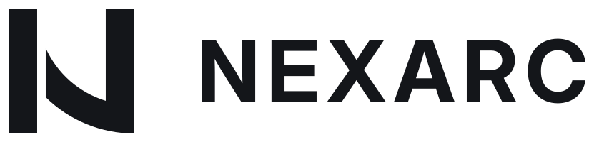
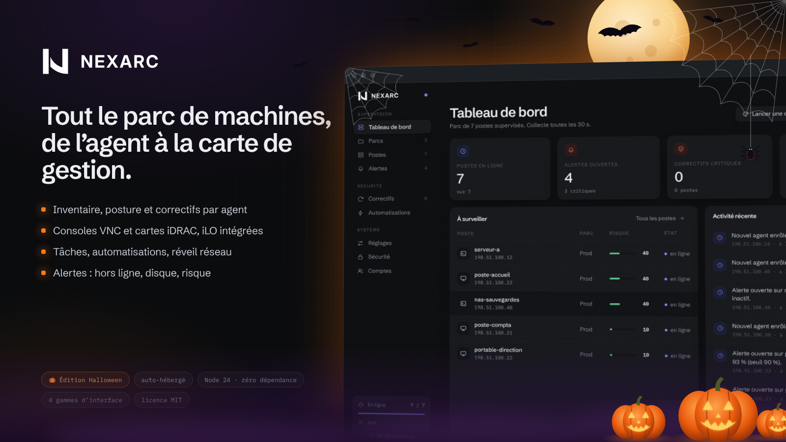
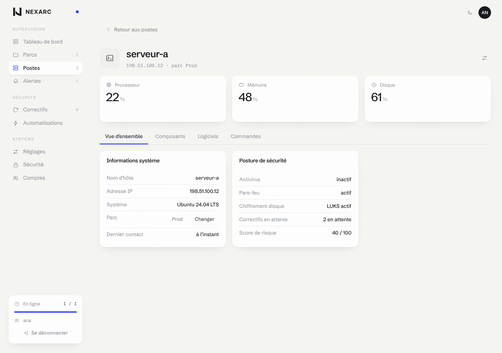
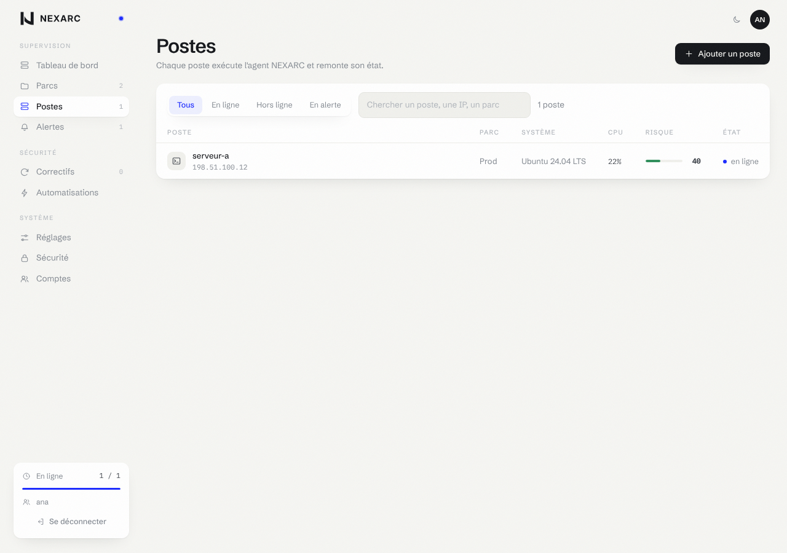
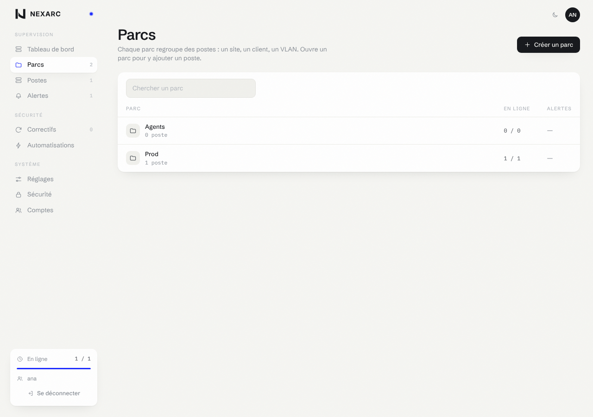
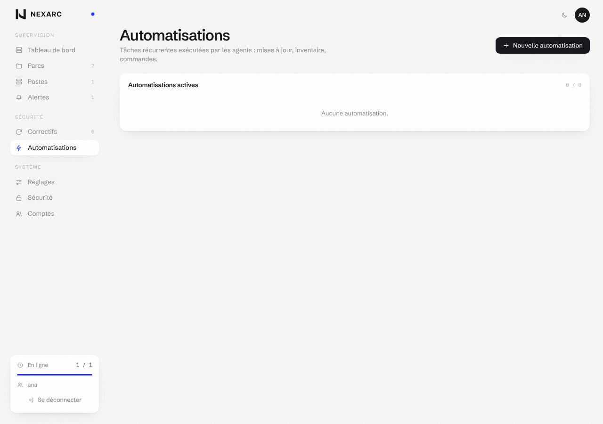

<p align="center">
  <picture>
    <source media="(prefers-color-scheme: dark)" srcset="medias/logo-sombre.svg">
    
  </picture>
</p>

<p align="center"></p>

# NexArc

**Self-hosted IT fleet management: inventory agents, security posture, remote tasks, built-in consoles and Wake-on-LAN — your whole fleet at a glance.**

<p align="center">

[](https://github.com/Nesaris/NexArc/stargazers)
[](LICENSE)


</p>

<p align="center"><a href="README.fr.md">Full documentation</a> · <a href="https://nesaris.github.io">Nesaris Network</a></p>

## Why NexArc?

Commercial RMM tools are expensive and send your fleet data to someone else's cloud. NexArc gives you the core of an RMM on your own server.

## Features

- **Fleet inventory** — each machine reports OS, CPU/RAM/disk metrics, hardware, software and pending updates through a lightweight agent.
- **Security posture** — antivirus, firewall, disk encryption and patch status, with a risk score per machine.
- **Sites / groups** — organize machines by site, customer or VLAN.
- **Remote tasks & automations** — inventory, install, uninstall, update, wake; scheduled tasks on any group.
- **Alerts** — machine offline, antivirus missing, firewall off, disk not encrypted, security patches pending, disk full; live activity feed (SSE).
- **Built-in consoles** — full-screen VNC (password never leaves the server), out-of-band interfaces (iDRAC, iLO, IPMI, JetKVM…) through a filtering reverse proxy, MeshCentral remote desktop.
- **Remote control through the agent** — screen and terminal of every machine (Windows, macOS, Linux with or without a display) over a connection the agent opens itself: no inbound port on the machines. The agent installs and configures the local screen server. Admin only, with recent re-authentication, every session logged.
- **Power** — shut down, restart, prepare Wake-on-LAN from the machine page; tasks reach the agent instantly; agents update themselves.
- **Redfish power control** and **Wake-on-LAN** through a relay agent on the same segment.

## Screenshots

<table>
<tr><td align="center" width="50%"><br><sub>Machine details</sub></td><td align="center" width="50%"><br><sub>Machines and risk</sub></td></tr>
<tr><td align="center" width="50%"><br><sub>Sites</sub></td><td align="center" width="50%"><br><sub>Automations</sub></td></tr>
</table>

## Quick start

```bash
git clone https://github.com/Nesaris/NexArc && cd NexArc
cp .env.example .env    # set NEXARC_HUB_TOKEN (openssl rand -hex 24)
mkdir -p secrets && openssl rand -base64 32 > secrets/socle_cle && : > secrets/socle_cle_ancienne
sudo chown 10001:10001 secrets/socle_cle secrets/socle_cle_ancienne && sudo chmod 400 secrets/socle_cle secrets/socle_cle_ancienne
docker compose up -d --build
docker compose logs nexarc | grep "Jeton d'installation"   # one-time setup token
```

Open `http://<host>:8090`, paste the setup token and create your account. Or install it from the [Nesaris Hub](https://github.com/Nesaris/Hub) catalog.

Full documentation (configuration, backups, key rotation, reverse proxy, upgrades) is in **[README.fr.md](README.fr.md)**.

## Part of Nesaris Network

NexArc is one of the self-hosted tools of **[Nesaris Network](https://nesaris.github.io)**. Every service shares the same hardened core (accounts, passkeys, TOTP, audit log, encrypted secrets), runs on Node.js 24 with **zero npm dependencies**, and can be installed in one click from the **[Nesaris Hub](https://github.com/Nesaris/Hub)**.

Other projects: [Hub](https://github.com/Nesaris/Hub) · [MapMyLAN](https://github.com/Nesaris/MapMyLAN) · [ProxLab](https://github.com/Nesaris/ProxLab) · [Vigie](https://github.com/Nesaris/Vigie) · [Relay](https://github.com/Nesaris/Relay) · [Nesmail](https://github.com/Nesaris/Nesmail) · [Synapse](https://github.com/Nesaris/Synapse) · [Dialekt](https://github.com/Nesaris/Dialekt)

## Contributing

Issues and pull requests are welcome. If NexArc is useful to you, a ⭐ helps a lot — it's how other people find the project.

## License

[MIT](LICENSE) — made by [CodeX64](https://codexx64.github.io).
